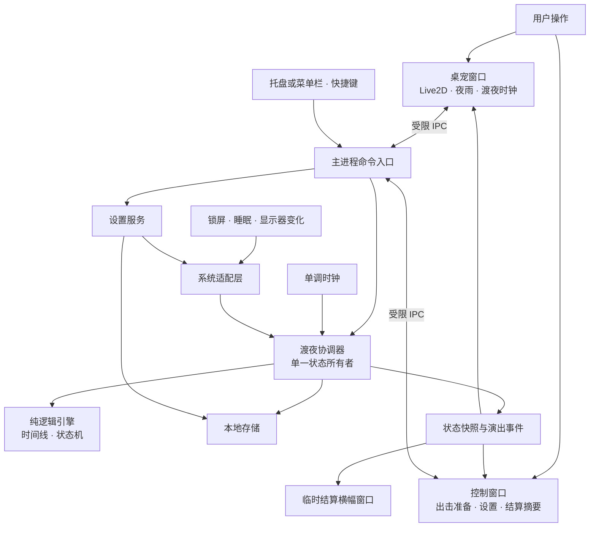
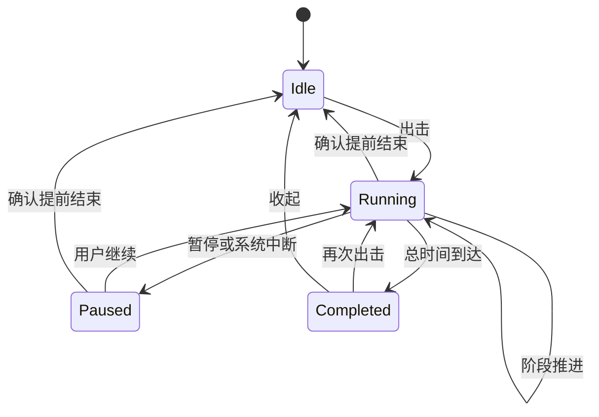

# 黑夜君临小蜗桌宠技术架构设计

设计版本 0.4 · 2026-11-22 · 桌宠 0.2.0 已接入自制复仇者 Cubism 模型。Windows 和 macOS 桌面行为待实机验收。

需求基线：[产品规格书](../SPEC.md)。技术依据：[类似产品与最终选型报告](research/tech-selection/2026-11-22_decision.md)。本文确定第一版技术路线、模块职责、运行流程和验证方式，不表示已经通过实机验收。

采用规格驱动开发（SDD）：产品规格 → 架构审阅与选型调研 → 关键能力验证 → 详细接口与任务拆分 → 实现与验收。用户已认可模块架构和 Electron 选型。详细契约见 [实现规格](IMPLEMENTATION_SPEC.md)，实现入口见 [README](../README.md)，实际验证情况见 [测试报告](TEST_REPORT.md)。产品规格保持不变；尚未满足的验收项必须在报告中列出。

## 1 架构结论

第一版采用 Electron + TypeScript，以本地桌面应用交付。主进程独占渡夜状态、计时、配置和系统操作；桌宠窗口负责 Live2D、夜雨和渡夜时钟；控制窗口负责出击准备、设置和恢复确认。两个窗口通过受限接口与主进程通信，不互相写状态。

渡夜引擎是独立于 Electron 的纯 TypeScript 模块。它接收命令和有效时间，产出当前阶段及事件。模型、动画、声音和窗口都不能推进游戏阶段。

应用无需后端、账号、数据库服务或游戏进程接入。资源随发行包提供，用户数据存储在系统应用数据目录。



图中箭头表示职责和数据流，不要求每个方框都是单独进程。常驻业务运行在一个主进程；Electron 自身还包含渲染、GPU 等辅助进程。

## 2 技术选型与取舍

| 部分 | 确定选择 | 原因与边界 |
| --- | --- | --- |
| 桌面容器 | Electron | 已有透明窗口、鼠标穿透、托盘、快捷键与电源事件接口；统一 Chromium 渲染环境 |
| 语言 | TypeScript，严格类型检查 | 核心逻辑、IPC 契约和前端共享类型；跨进程输入仍需运行时校验 |
| 面板界面 | React + CSS | 用于设置表单、渡夜时钟和准备面板；不负责逐帧驱动 Live2D |
| 构建 | electron-vite | 分别处理主进程、preload、renderer，参考 Open-LLM-VTuber 与 AIRI 的实际工程入口 |
| 模型渲染 | 官方 Cubism SDK for Web，封装 Live2DAdapter | 直接支持模型、动作、表情与物理资源，避免让业务依赖某个第三方包装库 |
| 氛围效果 | 独立 Canvas 2D 层，少量 CSS 转场 | 第一版只有局部光环和夜雨，不引入完整游戏引擎 |
| 声音 | Web Audio，统一 AudioDirector | 提示音、战斗音与音乐分通道控制 |
| 存储 | 带版本的本地 JSON 文件 | 数据量小，无查询或多用户需求；主进程串行写入 |
| 验证 | Vitest 核心测试；桌面自动化与双平台人工验证 | 时间规则与平台窗口行为分别验证 |
| 打包 | electron-builder | Windows安装程序与macOS DMG；在平台验证阶段落实签名配置、架构及最低系统版本 |

Electron 的桌面能力有官方接口支持，但“透明且不抢焦点、模型命中区域准确、双平台睡眠恢复”仍须组合验证。[窗口 API](https://www.electronjs.org/docs/latest/api/browser-window/)、[电源事件](https://www.electronjs.org/docs/latest/api/power-monitor)、[进程模型](https://www.electronjs.org/docs/latest/tutorial/process-model)。

Electron 的代价是携带 Chromium 和 Node.js，基础体积与内存占用不能忽略。这里将“轻量”首先落实为少操作、少常驻窗口、低动画负载；具体资源预算要在目标设备上测量，不能把框架选定当成性能已达标。

Tauri 是保留方案：DesktopMascot已有真实双平台源码原型，Kagami有Windows Live2D实现，不能以功能不可行为理由淘汰它。最终选择Electron，是考虑官方锁屏与睡眠接口、统一Chromium和Open-LLM/AIRI的实现参照；Tauri仍需两端WebView与系统适配验证。若真实小蜗在目标设备上经优化仍超出明确资源预算，再做同模型Tauri对照。Qt与Unity/Godot也有可行路线，但本版没有足够需求抵消新增原生或游戏引擎集成成本。详见[选型报告](research/tech-selection/2026-11-22_decision.md)。

Live2D采用官方SDK，不默认引入Pixi。Open-LLM当前源码提供直接先例；现代Pixi分支也能支持新模型，排除理由是本版单角色加局部夜雨不需要额外场景图层。Framework、Core与模型导出版本必须作为一个兼容组合锁定。[迁移与当前源码证据](research/tech-selection/sources/live2d_04_openllm_migration.md)

实现依赖已采用精确版本并由 package-lock.json 锁定；以 npm ci 重建。Electron 45.4.1、React 19.3.1、TypeScript 7.0.2、Cubism Framework 5-r.5；Core 与 Framework 来源及许可见角色资源记录。

## 3 进程和窗口边界

### 3.1 主进程

主进程负责应用单实例锁、渡夜协调器、计时器、系统事件、窗口创建、本地存储、全局快捷键和托盘菜单。所有出击入口最终调用同一个命令处理器。

主进程不执行 Live2D 渲染，不同步加载大体积模型，不在计时路径执行阻塞文件读写。

### 3.2 桌宠窗口

透明、无边框、默认置顶，包含小蜗、局部效果、渡夜时钟和局部结算横幅。正常运行只保留这一业务渲染窗口；只在用户打开控制面板时创建控制窗口。

透明桌宠窗使用resizable:false，不提供原生边框缩放。设置中的大小调整通过受控程序边界调整实现；若目标平台不能稳定保持透明，则保存状态后重建窗口。需要验证缩放不截断模型、不跳动屏幕位置。[官方透明窗口限制](https://www.electronjs.org/docs/latest/tutorial/custom-window-styles)

桌宠窗口不接受键盘焦点，不弹出系统通知抢占课堂。拖动采用指针位移命令，由主进程更新窗口位置；超过拖动阈值后不产生点击。窗口移动命令限频并校验坐标。

透明像素不自动等于鼠标穿透。采用模型命中区域与时钟表冠联合判定，空白区域切换为忽略鼠标事件；模型区域命中后允许点击和拖动。用户显式开启穿透时覆盖全部命中判定。该行为是双平台验证重点，不能仅靠 CSS pointer-events 宣称通过。

setIgnoreMouseEvents的forward选项用于保留两端鼠标移动事件。Windows前台高权限窗口可能使转发暂时失效，此时仍保留托盘与快捷键恢复，不为桌宠请求管理员权限。[接口边界](research/tech-selection/sources/platforms_14_electron_mouse_forward.md)

第一版覆盖普通桌面窗口上的置顶；独占全屏应用及 macOS 全屏空间中的表现须单独记录，不以平台无法保证的“始终盖在所有窗口上”作为默认承诺。

### 3.3 控制窗口

一个可聚焦的普通窗口，通过内部路由复用出击准备、四页设置、恢复提示和结算摘要。只在用户主动打开时获取焦点。关闭时销毁窗口；主进程与渡夜继续运行。未保存的时间设置草稿按规格确认保存或放弃。

控制窗口不初始化 Live2D 模型。演出预览优先发送给桌宠窗口的独立预览通道，结束后重新应用真实会话快照；不触发业务命令，不修改绝招记录。若真实渡夜正在运行，阶段转场可终止预览。

### 3.4 临时结算窗口

选择屏幕中央结算时，临时创建横幅大小的透明窗口，放在小蜗所在显示器中央。窗口不可聚焦、完全鼠标穿透，结束后销毁；不创建常驻全屏透明窗口。音效仍由桌宠窗口唯一播放。

### 3.5 窗口失败

桌宠渲染进程退出时，主进程暂停渡夜并保存，尝试重建窗口后请求用户继续。普通画面掉帧不暂停，恢复后直接显示当前阶段。控制窗口崩溃不暂停渡夜，可重新打开。

隐藏小蜗只停止或降低视觉更新，不暂停业务；声音按已有设置继续。桌宠渲染器仍需接收音频事件，不能依赖隐藏页面的 requestAnimationFrame 播放声音。后台音频行为列入验证，必要时调整该窗口节流配置。

## 4 模块职责和依赖方向

| 模块 | 负责 | 不负责 |
| --- | --- | --- |
| TimelineCompiler | 校验三种时间模式，编译不可变阶段列表 | 读取系统时间、播放动画 |
| ExpeditionEngine | 根据有效用时计算阶段、血条和状态转换 | Electron API、文件和资源 |
| SessionController | 串行处理命令，维护运行会话、计时锚点、事件编号 | 模型参数与 UI 表单状态 |
| SettingsService | 校验配置、管理预设、协调即时设置与系统结果 | 修改当前会话时间线 |
| PlatformAdapter | 窗口、托盘、快捷键、开机启动、锁屏和睡眠适配 | 渡夜阶段规则 |
| Persistence | 校验、迁移、备份、原子替换和串行写入 | 决定业务成功或失败 |
| PresentationDirector | 将快照与事件转为模型、光环、标题和声音表现 | 产生阶段跳转 |
| Live2DAdapter | 加载模型，映射动作和表情，管理渲染资源 | 决定何时进入夜王战 |
| AudioDirector | 分通道音量、静音、暂停、音效去重 | 改变会话状态 |

依赖方向：界面 → IPC 契约 → 应用服务 → 纯逻辑模块。系统和存储通过接口注入应用服务。纯逻辑模块不 import Electron、React、Live2D 或 Node.js 文件模块，便于用模拟时钟直接验证规则。

## 5 时间与状态模型

### 5.1 时间线编译

输入为用户选定预设，输出包含 11 个阶段，每个阶段有稳定 ID、类型、起止毫秒值及所属天数。所有输入按整数秒校验后转为毫秒。范围使用 `[startMs, endMs)`，阶段总长与总时长必须一致。

原作模式固定两个白天各四段；适配课长使用规格中的带下限比例分配与最大余数取整；自定义逐段编译。预览和真实出击使用同一个编译器，避免显示与执行不一致。

点击出击时，将编译结果复制到会话内。之后预设的修改、重命名或删除均不影响本局。

### 5.2 单一有效时间

运行时有效用时为：`累计已运行毫秒 + 当前单调时钟值 - 本次继续时的单调时钟值`。暂停时先结算累计值，再清空运行锚点；继续时重建锚点。持久化只保存累计有效时间，不保存可跨进程复用的时钟锚点。

生产时钟通过接口封装，首选主进程单调计时源；墙上时间仅用于文件时间戳和日志。定时器只负责唤醒计算，不作为时间本身。阶段边界由有效时间决定。手动施放绝招通过独立演出事件传递。

主进程按下一阶段边界安排唤醒，并约每 250 毫秒发布运行快照。界面可插值表现，但插值不能产生成功、进入下一阶段或发送最终攻击；这些只能由主进程授权。主线程阻塞后直接计算当前位置，跳过过期演出，不批量补播声音。

### 5.3 状态机



恢复的未完成会话一律进入 Paused，记录暂停原因。Completed 保存最后一局结果，显示横幅的 5 秒是演出时间，不属于有效课程时间。模型动画完成回调不能触发业务完成。

### 5.4 睡眠和锁屏

系统适配层将 suspend、resume、lock-screen、unlock-screen 转为统一事件。睡眠总是暂停；锁屏按设置决定。解锁和唤醒不自动继续。[Electron powerMonitor](https://www.electronjs.org/docs/latest/api/power-monitor)

各平台单调时钟对睡眠时间的处理及系统事件到达顺序必须实测。正常路径在 suspend 通知时结算并暂停；resume 时仍设置为暂停。如果未观察到配对 suspend，则恢复到最近持久化检查点并提示暂停，不以墙上时间补算睡眠期间的“学习”。该异常路径可能回退少量进度，需在验证报告记录。

锁屏设置关闭时，锁屏期间主进程继续推进，暂不播放阶段提示；解锁只发送当前状态。若已完成，显示结算摘要而不补播历史阶段音效。

## 6 命令和状态通信

Preload 只暴露明确方法，不开放通用 ipcRenderer、文件系统或任意频道调用。主进程校验调用窗口身份、参数类型及当前状态。渲染器启用 contextIsolation 和 sandbox，关闭 nodeIntegration，只加载应用本地内容。[Electron 安全指南](https://www.electronjs.org/docs/latest/tutorial/security)

| 命令 | 结果与限制 |
| --- | --- |
| startExpedition(presetId, requestId) | 主进程读取并编译预设；已有活动会话时拒绝重复出击 |
| pause / resume / abandon(sessionId) | 校验会话身份与状态；结束确认在控制层完成 |
| useUltimate(sessionId, stageId) | 仅当前战斗且未使用时成功；旧阶段请求拒绝 |
| previewTimeline(draft) / savePreset(draft) | 共用编译器；不会修改当前会话 |
| updatePreferences(patch, expectedRevision) | 校验后应用；过期编辑返回冲突，刷新后重试 |
| openControl / resetPosition / setClickThrough | 由主进程校验并调用窗口接口 |
| getSnapshot / subscribe | 返回当前版本快照，订阅后按版本丢弃旧数据 |

所有会话命令串行处理，重复 requestId 返回既有结果，不重复生成事件。命令失败返回可展示的错误码与简短说明，不悄悄忽略。

状态快照包含 `sessionId、revision、status、elapsedMs、phase、phaseRemainingMs、totalRemainingMs、ultimateUsed、preferencesRevision`。演出事件包含 `eventId、sessionId、revision、kind、phaseId`。时间线和资产清单按需传输，不在每帧重复传送。

首次订阅返回当前快照；版本检查处理“订阅和读取之间发生更新”的情况。窗口重新加载后以最新快照重建画面，不重播全部历史事件。事件去重保证正常运行中一次演出只触发一次；跨进程崩溃后的短暂动画不承诺严格恰好一次，业务结算则必须持久化去重。

## 7 Live2D 与演出解耦

模型资源包包含 `.model3.json`、`.moc3`、贴图及已有动作、表情和物理数据。由 Live2DAdapter 根据模型清单加载，不把模型内部动作名写入渡夜引擎。[Live2D 模型加载说明](https://docs.live2d.com/en/cubism-sdk-manual/model-web/)

增加应用自己的资源映射清单，声明 `idle、touch、battle、ultimate、victory` 对应哪些动作或参数，并记录缩放、命中区域和可用能力。模型没有某个动作时，由现有表情、光效或姿态组合明确降级；不能把动画名称存在当成模型具备对应动作。

模型使用独立WebGL canvas，夜雨使用另一个Canvas2D，两层共用逻辑坐标、DPR和缩放约定，不共享上下文。夜雨层设置pointer-events:none；模型层命中只提供判定结果，操作系统穿透仍由主进程控制。保留硬件加速，验证WebGL上下文丢失恢复和资源释放。不得把关闭GPU作为透明窗口的默认修复手段。

桌宠和控制面板从同一快照读取阶段倒计时和整局倒计时。渡夜时钟用整局有效用时驱动指针，按时间线计算各阶段刻度。提示音、绝招和胜利横幅由事件触发。暂停冻结战斗与进度效果，允许不表达时间推进的轻微待机。

动作播放与阶段推进各自计时。连续施放绝招保留一个后续动作，当前动作收势后接上。暂停期间允许播放用户主动触发的绝招。

模型加载失败时仍保留托盘和控制面板，展示具体缺失资源并允许重试。该状态下可以验证计时逻辑，但不能标为桌宠成品验收通过。正式资源仅从应用资源根加载，不使用远程 CDN。

## 8 设置与持久化

### 8.1 设置生效规则

时间预设采用草稿加保存；一般显示与音量设置即时应用并串行保存。快捷键、开机启动等系统设置先执行操作并检查结果，再更新成功状态；失败保留旧值。

安静模式是覆盖层：有效静音为“总静音或安静模式”，有效演出强度在安静模式下为低。底层用户音量和演出偏好不被覆盖，退出安静模式即可恢复。

### 8.2 本地文件

| 文件 | 内容 |
| --- | --- |
| preferences.json | schemaVersion、revision、桌宠、声音、演出、快捷键和运行偏好 |
| presets.json | schemaVersion、用户预设、选中预设 ID；内置预设在应用内定义 |
| session.json | schemaVersion、sessionId、状态、时间线快照、有效用时、结算标记 |
| window-state.json | 显示器线索、逻辑坐标、大小；恢复时重新限制在可用区域内 |

数据根目录使用 Electron 的 userData 路径。显示器 ID 只作线索，断开显示器后重新选择主屏幕，不能直接恢复不可见坐标。

主进程唯一写入，每个文件串行处理。采用同目录临时文件写入、校验、刷新并替换正式文件，保留上一份有效备份。Windows 文件占用导致替换失败时保留旧文件并报告错误，不先删除唯一有效副本。启动时校验版本和结构；无法解析时使用有效备份，保留损坏文件供排查。

运行检查点目标每 2 秒保存一次，并监控距最近成功保存时间。出击、暂停、阶段切换、结束和成功结算立即安排保存。完成写入后再播放胜利演出。手动施放不死行军只投递演出事件，不触发存档。

规格中的“异常关闭最多丢失 5 秒”是正常可写存储下的验收目标；写入持续失败时无法保证。超过 5 秒没有成功检查点时自动暂停并显示保存故障，提供重试；不继续静默运行。突然断电的持久性需随目标文件系统实测，不能仅凭调用 rename 宣称已保证。

## 9 性能与运行故障

第一版只有一份常驻模型实例。默认动画目标 30 FPS；设置面板按需创建，中央横幅结束后释放。减少粒子、限制贴图尺寸和释放不用的音频缓冲优先于引入新进程。

隐藏桌宠时停用视觉渲染，保留业务计时与所需音频；控制面板关闭后销毁其渲染资源。待机、探索、强演出和隐藏四种状态分别测量 CPU、GPU、内存与功耗，记录模型大小与设备配置。性能预算在首轮模型验证后确定，不提供未经测量的资源占用数字。

主进程只保留有限本地诊断日志，记录阶段、错误和平台事件，不采集课堂内容。日志轮转，资源加载失败时保留路径与原因，避免无界增长。

## 10 建议目录

```text
SPEC.md
docs/
  TECHNICAL_DESIGN.md
  validation/                # 后续关键能力验证结果
src/
  core/                      # 时间线、状态机、类型，不依赖平台
  main/
    session/                 # 协调器、生产时钟、会话命令
    settings/                # 配置与预设服务
    platform/                # 窗口、系统事件、菜单、快捷键
    persistence/             # JSON 校验、迁移、保存与恢复
  contracts/                 # IPC 类型和运行时校验规则
  preload/                   # 受限桥接
  renderer/
    pet/                     # 桌宠与演出导演
    control/                 # 准备、设置、恢复、摘要
    overlay/                 # 中央结算横幅
    live2d/                  # SDK 适配与模型资源生命周期
    audio/                   # 音频导演
resources/                   # 经确认可分发的模型、字体、声音
tests/
  core/
  integration/
  desktop/
```

以上表示逻辑边界。实现中主进程模块保持为 src/main 下的独立文件，界面拆为 renderer/pages、components、pet、live2d；音频导演放在 pet，临时横幅入口复用 renderer/src/main.tsx。没有为单一文件建立空目录；不采用多包仓库、插件系统或独立后端。

## 11 需求到验证的对应关系

| 规格需求 | 架构承担者 | 验证方式 |
| --- | --- | --- |
| SPEC 2 默认时间线与三种模式 | TimelineCompiler、ExpeditionEngine | 可控时钟验证所有 11 段边界，31／40／45 分钟及非法输入 |
| SPEC 3 出击与结算包装 | 控制窗口、PresentationDirector | UI 流程、固定文案、无操作完成、提前结束不胜利 |
| SPEC 4 轻互动不影响时间 | 演出事件、Live2DAdapter | 任意阶段重复双击，暂停时演出且计时冻结 |
| SPEC 5 设置灵活生效 | SettingsService、会话快照 | 当前局隔离、下局应用、系统操作失败、版本冲突 |
| SPEC 6 穿透与找回入口 | PlatformAdapter | 两端真实桌面验证穿透、托盘恢复、拖动、显示器拔插 |
| SPEC 7 计时与恢复 | 单调时钟、系统适配、Persistence | 暂停、睡眠、锁屏、修改系统日期、强制退出、文件损坏 |
| SPEC 8 双平台与完整体验 | 全部模块 | 每端实跑 40 分钟，记录计时误差、焦点和资源使用 |

纯逻辑测试不能代替双平台桌面验证。浏览器中的透明背景截图也不能证明操作系统鼠标穿透、置顶和睡眠恢复正确。

## 12 实施与剩余验收

1. 验证平台能力：透明非聚焦窗口、命中区域穿透、托盘找回、锁屏睡眠、显示器变化、隐藏时音频。macOS 与 Windows 分别记录结果。
2. 验证实际小蜗模型：确定资源来源、SDK 兼容、动作映射、加载方式和性能；确认所需素材可随应用提供。
3. 根据验证结果确定框架版本、目标系统与资源预算，修订本文并记录决策变化。
4. 再形成接口细化与任务清单，按“计时核心 → 系统与存储 → 桌宠演出 → 设置与发行”实现，并逐项对应规格验收。

目前已完成接口契约、计时与存储、窗口与设置、桌宠演出和 SDK 适配。自制小蜗通过官方 Core 的一致性校验，模型包含七组动作，分别对应待机、触碰、三场战斗、绝招和胜利。模型的制作资料、Linux 实测与目标系统验收分别记录。[角色资料](CHARACTER_ASSETS.md) · [测试报告](TEST_REPORT.md)
